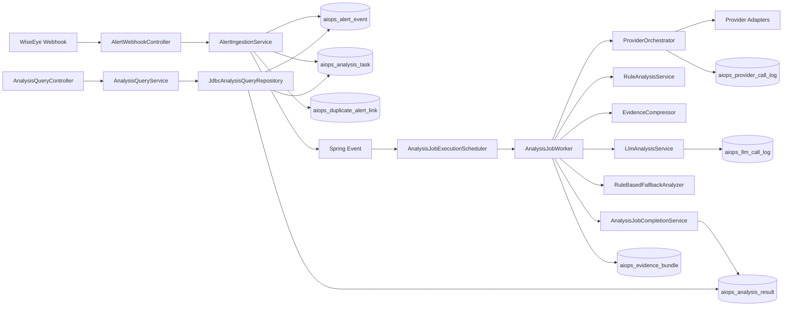

# AIOps Alert Analysis 项目架构文档

## 1. 文档目标

本文档描述当前工程的实际架构实现，用于帮助开发、联调、排障和后续扩展。它不是设计草案的重复整理，而是以当前代码为准，对系统边界、模块职责、主执行链路、数据模型、线程模型和扩展点进行说明。

## 2. 项目概览

项目名称：`aiops-alert-analysis`

技术栈：

- Java 21
- Spring Boot 3.2.5
- Spring JDBC
- MySQL 8
- Flyway
- Jackson

当前系统定位：

- 接收 WiseEye 风格原始告警文本
- 将告警解析为结构化事件
- 在 5 分钟去重窗口内复用已有分析任务
- 对未命中去重的告警发起异步分析
- 并行采集多类 Provider 证据
- 基于规则引擎和可选 LLM 生成最终分析结果
- 持久化任务、结果、证据包和调用日志
- 提供任务查询、最新结果查询、历史查询接口

当前支持的告警类别：

- `RPC_ERROR_RATE`
- `RPC_LATENCY`

## 3. 总体架构

系统整体采用“同步接入 + 事务内落库 + 事务后异步执行 + JDBC 持久化 + 可选 LLM 增强”的分层架构。

## 4. 分层与模块职责

### 4.1 `alert` 模块

职责：

- Webhook 接口暴露
- 原始告警解析
- 告警分类
- 去重键生成
- 去重与历史参考判定
- 新任务创建与异步调度

关键类：

- `AlertWebhookController`：接收 `/api/v1/alerts/webhook`
- `AlertIngestionService`：接入主服务
- `AlertParser`：原始文本转 `AlertEvent`
- `AlertClassifier`：识别 `RPC_ERROR_RATE` / `RPC_LATENCY`
- `DedupeKeyGenerator`：生成 `category|service|interface|cluster`
- `AlertDeduplicationService`：判定复用任务或返回历史参考

### 4.2 `analysis` 模块

职责：

- 任务生命周期编排
- 分析上下文构建
- Provider 证据采集结果承载
- 规则分析
- 证据压缩
- 规则降级结果生成
- 结果持久化与查询

关键子包：

- `analysis.context`：根据告警构建告警窗口、基线窗口、采样上限
- `analysis.orchestrator.state`：显式状态机
- `analysis.orchestrator.worker`：异步执行主链路
- `analysis.rule`：规则分析入口与分类规则分析器
- `analysis.bundle`：证据压缩与 evidenceId 管理
- `analysis.fallback`：规则降级输出
- `analysis.query`：查询接口与视图装配
- `analysis.result`：最终结果模型

### 4.3 `provider` 模块

职责：

- 屏蔽外部证据源差异
- 统一 Provider 调用超时、重试、日志
- 组织资源映射、基线、接口日志、Trace、运行日志、指标采集

当前实现形态：

- `JdbcResourceMappingProvider`：资源映射来自 MySQL
- 其他 Provider 当前默认由 mock 实现承担本地可运行和测试能力

关键类：

- `DefaultProviderOrchestrator`
- `ProviderCallExecutor`
- `MockBaselineProvider`
- `MockInterfaceLogProvider`
- `MockTraceProvider`
- `MockRuntimeLogProvider`
- `MockMetricProvider`

### 4.4 `llm` 模块

职责：

- 按告警类别构建 Prompt
- 调用指定 LLM Client
- 校验 JSON 输出结构和 evidenceId 引用
- 持久化 LLM 调用日志
- 将 LLM 输出转换为统一 `AnalysisResult`

当前实现形态：

- 默认 Provider：`mock`
- 可选 Provider：`openai-compatible`

关键类：

- `DefaultLlmAnalysisService`
- `RpcErrorRatePromptBuilder`
- `RpcLatencyPromptBuilder`
- `DefaultLlmOutputValidator`
- `MockLlmClient`
- `OpenAiCompatibleLlmClient`

### 4.5 `persistence` 模块

职责：

- 持久化接口定义
- JDBC 仓储实现
- 查询投影拼装

特点：

- 写路径与读路径分离
- 读查询通过 `JdbcAnalysisQueryRepository` 跨表拼装投影
- `AnalysisResult` 使用 `result_json` 保存完整结构化输出，同时保留少量冗余列供筛选和索引

### 4.6 `common` 模块

职责：

- 统一 API 返回格式
- 配置绑定
- 全局异常处理
- 健康检查
- JSON 工具封装
- 异步线程池配置

## 5. 核心执行链路

### 5.1 告警接入链路

1. `AlertWebhookController` 接收原始文本。
2. `AlertIngestionService` 调用 `AlertParser` 和 `AlertClassifier` 生成 `AlertEvent`。
3. 校验告警关键字段：`alertId`、`serviceName`、`interfaceName`、`cluster`、`metricOccurTime`。
4. 生成 `dedupeKey`。
5. `AlertDeduplicationService` 在去重窗口内查询可复用任务。
6. 若命中重复告警：
   - 写入 `aiops_duplicate_alert_link`
   - 直接返回已存在任务 ID
7. 若未命中重复：
   - 写入 `aiops_alert_event`
   - 创建 `PENDING` 状态任务到 `aiops_analysis_task`
   - 发布 `AnalysisJobExecutionRequestedEvent`

### 5.2 异步分析链路

`AnalysisJobExecutionScheduler` 通过 `@TransactionalEventListener(AFTER_COMMIT)` 在事务提交后触发 `AnalysisJobWorker.submit(taskId)`，避免任务记录未提交时工作线程抢跑。

`AnalysisJobWorker` 的执行阶段如下：

1. `RUNNING`：领取任务并加载告警
2. `COLLECTING_EVIDENCE`：并行采集 Provider 证据
3. `RULE_ANALYZING`：执行规则分析
4. `COMPRESSING_EVIDENCE`：压缩证据并持久化 evidence bundle
5. `LLM_ANALYZING`：如果 LLM 开启则构建 Prompt 并调用模型
6. `RULE_FALLBACK_ANALYZING`：当 Provider 关键证据缺失或 LLM 失败时走降级分析
7. `GENERATING_RESULT`：生成最终结果
8. `SUCCESS` 或 `DEGRADED_SUCCESS`：持久化结果并结束
9. 任意未处理异常：进入 `FAILED`

### 5.3 查询链路

查询接口由 `AnalysisQueryController` 暴露：

- `GET /api/v1/analysis/tasks/{taskId}`
- `GET /api/v1/analysis/latest?alertId=...`
- `GET /api/v1/analysis/history?serviceName=...&interfaceName=...&limit=...`

查询服务使用 `JdbcAnalysisQueryRepository` 联合读取：

- `aiops_analysis_task`
- `aiops_alert_event`
- `aiops_analysis_result`
- `aiops_duplicate_alert_link`

对于旧数据，如果 `result_json` 内没有 `historicalReference`，`AnalysisQueryService` 会按 `dedupeKey` 回查历史结果进行兼容补齐。

## 6. 状态机设计

任务状态由 `DefaultAnalysisJobStateMachine` 统一维护，禁止业务代码直接改任务状态。

支持状态：

- `PENDING`
- `RUNNING`
- `COLLECTING_EVIDENCE`
- `RULE_ANALYZING`
- `COMPRESSING_EVIDENCE`
- `LLM_ANALYZING`
- `RULE_FALLBACK_ANALYZING`
- `GENERATING_RESULT`
- `SUCCESS`
- `DEGRADED_SUCCESS`
- `FAILED`
- `SKIPPED_DUPLICATE`

架构意义：

- 状态迁移集中校验
- 通过 `state_version` 做乐观锁控制
- 每次迁移都写 `aiops_analysis_job_state_log`
- 异步执行失败时可保留清晰审计轨迹

## 7. Provider 采集架构

### 7.1 采集内容

当前 Provider 编排会采集：

- 资源映射
- 历史基线
- 接口日志
- Trace
- 运行日志
- 容器指标
- CSE 指标
- 数据库指标
- DCS 指标
- MQ 指标

### 7.2 编排特点

`DefaultProviderOrchestrator` 的主要策略：

- 独立 Provider 优先并行
- Trace 和运行日志依赖接口日志中采样出的 traceId
- 资源映射先完成，再决定是否查询 DB/DCS/MQ 指标
- 每个 Provider 调用都通过 `ProviderCallExecutor`

`ProviderCallExecutor` 负责：

- 独立线程池执行
- 超时控制
- 短重试
- `ProviderResult` 标准化
- `aiops_provider_call_log` 审计落库

### 7.3 降级策略

以下情况会触发规则降级路径：

- 接口日志不可用
- `RPC_LATENCY` 告警下 Trace 不可用
- 配置要求非关键 Provider 失败也不能继续
- LLM 调用失败且允许 fallback

降级结果不会自动执行处置动作，只会输出分析、影响和建议。

## 8. 规则分析与证据压缩

### 8.1 规则分析

规则分析入口为 `DefaultRuleAnalysisService`，按告警类别分派到：

- `DefaultErrorRateRuleAnalyzer`
- `DefaultLatencyRuleAnalyzer`

规则分析输出包括：

- rule findings
- candidate root causes
- errorCode 分布
- uid 分布
- trace 观察结果
- downstream 观察结果
- metric anomaly
- insufficient evidence

### 8.2 证据压缩

`DefaultEvidenceCompressor` 的目标是把大体量原始证据整理成适合 LLM 和接口返回的稳定结构：

- 生成稳定 evidenceId
- 保留规则结论引用到的关键证据
- 对错误码、UID、trace、运行日志做上限裁剪
- 记录 `insufficientEvidence`
- 输出 `CompressedEvidenceBundle`

压缩后证据会以 `rule` 和 `compressed` 两类 evidence bundle 持久化到 `aiops_evidence_bundle`。

## 9. LLM 架构

### 9.1 调用流程

1. `DefaultLlmAnalysisService` 根据告警类别选择 `PromptBuilder`
2. 构造 `LlmRequest`
3. 调用当前配置的 `LlmClient`
4. `DefaultLlmOutputValidator` 校验 JSON
5. 将输出转换为 `AnalysisResult`
6. 写入 `aiops_llm_call_log`

### 9.2 输出约束

LLM 输出必须满足：

- `summary` 非空
- `impact` 合法
- `rootCauses` 至少 1 条，最多 5 条
- `recommendations` 至少 1 条，最多 8 条
- `overallConfidence` 在 `[0,1]`
- 所有 `evidenceIds` 必须来自压缩证据包中已存在的 evidenceId

这意味着 LLM 在架构上是“受约束的增强器”，不是自由生成器。

### 9.3 当前运行模式

- 默认模式：`mock`
- 可切换到 `openai-compatible`

`openai-compatible` 需要配置：

- `aiops.llm.base-url`
- `aiops.llm.api-key`

## 10. 最终结果模型

最终分析结果统一使用 `AnalysisResult` 表达，核心字段包括：

- `analysisMode`
- `summary`
- `impact`
- `rootCauses`
- `recommendations`
- `evidenceRefs`
- `missingEvidence`
- `insufficientEvidence`
- `historicalReference`
- `llmUsed`
- `llmStatus`
- `degraded`
- `degradedByProviderFailure`
- `degradedReason`
- `ruleEngineVersion`
- `overallConfidence`
- `generatedAt`

这套结果模型同时承担两种角色：

- 面向查询接口返回
- 面向 `aiops_analysis_result.result_json` 持久化

## 11. 数据存储架构

### 11.1 核心表

- `aiops_alert_event`：原始告警与结构化字段
- `aiops_analysis_task`：分析任务主表
- `aiops_analysis_result`：最终结果主表
- `aiops_evidence_bundle`：规则证据与压缩证据
- `aiops_provider_call_log`：Provider 调用日志
- `aiops_llm_call_log`：LLM 调用日志
- `aiops_duplicate_alert_link`：重复告警复用关系
- `aiops_resource_mapping`：资源映射
- `aiops_analysis_job_state_log`：状态迁移审计日志

### 11.2 存储特点

- 任务和结果分表，便于区分过程态与终态
- 完整分析结果使用 JSON 持久化，兼顾演进灵活性
- 关键筛选字段保留冗余列，便于 SQL 查询和索引优化
- 证据包单独存储，避免结果表承载过大上下文

## 12. 线程与事务模型

### 12.1 线程池

当前定义了 3 个关键执行器：

- `analysisJobExecutor`
  - 异步任务主执行器
  - 让 Webhook 请求线程只负责接入和入库

- `providerExecutor`
  - 单个 Provider 调用执行器
  - 支持超时和重试控制

- `providerOrchestratorExecutor`
  - Provider 编排调度执行器
  - 避免外层编排落到 JDK common pool

### 12.2 事务边界

- 告警接入在 `AlertIngestionService.ingest()` 内使用事务
- 任务提交事件在事务提交后才触发工作线程
- 结果持久化与终态写回在 `AnalysisJobCompletionService.complete()` 内同事务完成
- 状态迁移由 `DefaultAnalysisJobStateMachine` 单独控制并写状态日志

## 13. 对外接口与系统边界

### 13.1 输入边界

- `POST /api/v1/alerts/webhook`
  - 输入为 `text/plain`
  - 接收原始告警全文

### 13.2 输出边界

- `GET /api/v1/analysis/tasks/{taskId}`
- `GET /api/v1/analysis/latest`
- `GET /api/v1/analysis/history`
- `GET /api/v1/health`

统一返回结构由 `ApiResponse<T>` 承担，异常由 `GlobalExceptionHandler` 映射为统一错误响应。

## 14. 当前扩展点

系统当前具备以下扩展能力：

- 新增告警类别
  - 扩展 `AlertCategory`
  - 增加分类逻辑、规则分析器、PromptBuilder

- 替换 Provider 实现
  - 保持 `Provider` 接口不变
  - 将 mock 改成真实适配器

- 替换 LLM Provider
  - 增加新的 `LlmClient`
  - 配置 `aiops.llm.provider`

- 扩展结果模型
  - 优先扩展 `result_json`
  - 必要时再增加结构化列和索引

## 15. 当前实现边界与约束

当前代码的架构边界如下：

- 任务调度是单体应用内的 Spring 事件 + 本地异步线程池，不是 MQ 驱动架构
- 除资源映射外，多数 Provider 当前仍以 mock 实现为主
- 默认 LLM 也是 mock，实现重点是接口、流程和验证约束
- 系统输出的是分析建议，不包含自动化处置执行链路
- 历史查询有服务层上限控制，默认最大值为 `5`

## 16. 配置说明

主要配置位于 `application.yml`：

- 数据源
  - `AIOPS_DATASOURCE_URL`
  - `AIOPS_DATASOURCE_USERNAME`
  - `AIOPS_DATASOURCE_PASSWORD`

- 分析配置
  - `aiops.analysis.dedupe-window`
  - `aiops.analysis.historical-reference-lookback`
  - `aiops.analysis.async-timeout`
  - `aiops.analysis.history-query-max-limit`

- Provider 配置
  - `aiops.provider.timeout`
  - `aiops.provider.retry-times`
  - `aiops.provider.parallel-enabled`
  - `aiops.provider.continue-on-non-critical-failure`

- LLM 配置
  - `aiops.llm.enabled`
  - `aiops.llm.provider`
  - `aiops.llm.model`
  - `aiops.llm.base-url`
  - `aiops.llm.api-key`

## 17. 测试架构

当前测试分为几层：

- 单元测试
  - 覆盖规则分析、状态机、结果补齐、Provider 编排、LLM 校验等

- 集成测试
  - 覆盖 JDBC 仓储、查询接口、状态机落库

- 端到端回放/Smoke 测试
  - 覆盖 webhook 接入、异步任务执行、LLM/规则降级、历史查询

这说明项目当前的架构不仅停留在接口定义层，而是已经具备可运行、可回放、可验证的实现骨架。

## 18. 建议的阅读顺序

如果第一次接手这个项目，建议按以下顺序阅读代码：

1. `AlertWebhookController`
2. `AlertIngestionService`
3. `AnalysisJobWorker`
4. `DefaultAnalysisJobStateMachine`
5. `DefaultProviderOrchestrator`
6. `DefaultRuleAnalysisService`
7. `DefaultEvidenceCompressor`
8. `DefaultLlmAnalysisService`
9. `DefaultRuleBasedFallbackAnalyzer`
10. `AnalysisJobCompletionService`
11. `AnalysisQueryService`
12. `JdbcAnalysisQueryRepository`

## 19. 架构结论

当前工程已经形成了比较清晰的“接入层 -> 编排层 -> 证据采集层 -> 规则/LLM 分析层 -> 持久化层 -> 查询层”结构。

它的核心优点是：

- 任务生命周期明确
- 读写职责分离
- Provider 和 LLM 都通过接口隔离
- 结果模型统一
- 降级路径明确
- 审计日志和证据包可追溯

后续如果要继续演进，最自然的方向是：

- 将 mock Provider 逐步替换为真实生产适配器
- 为历史查询增加更完整的分页语义
- 增加后台清理任务处理证据和日志过期数据
- 在保持结果模型稳定的前提下扩展新的告警类别和规则
